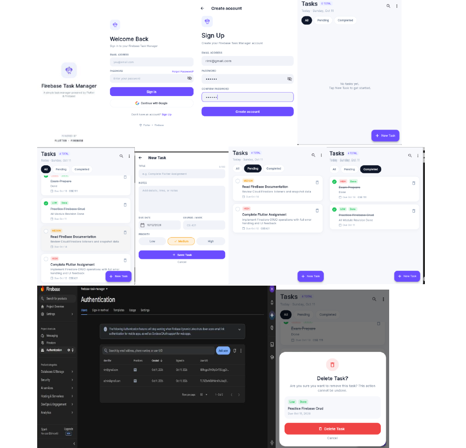

# 📱 Firebase Task Manager

<p align="center">
 <p align="center">
  
</p>
</p>

<p align="center">
  A Flutter-based Task Management App powered by Firebase, featuring secure authentication, real-time task management, push notifications, and local notifications.
</p>

<p align="center">
  
  
  
  
</p>

## ✨ Features

- **Authentication:** Email/password sign-up, sign-in, Google Sign-In, and password reset.
- **Task Management:** Create, view, update, and delete tasks using Cloud Firestore.
- **Task Details:** Manage task titles, descriptions, due dates, priorities, and completion status.
- **Search & Filters:** Search tasks and filter by All, Pending, or Completed.
- **Delete Confirmation:** Confirmation sheet before deleting a task.
- **Push Notifications:** Firebase Cloud Messaging (FCM) integration.
- **Local Notifications:** Display notifications while the app is in the foreground.
- **Background Notifications:** Receive Firebase notifications when the app is in the background or terminated.
- **Notification Navigation:** Open the related task when a notification contains a valid `taskId`.
- **Priority-Based Notifications:** Support for high, medium, and low task priorities.
- **FCM Token Management:** Save the user's FCM token in Cloud Firestore.

## 🛠️ Technologies

- **Framework:** Flutter
- **Programming Language:** Dart
- **Authentication:** Firebase Authentication
- **Database:** Cloud Firestore
- **Push Notifications:** Firebase Cloud Messaging (FCM)
- **Local Notifications:** `flutter_local_notifications`
- **Google Authentication:** Google Sign-In

## 📦 Package Information

| Platform | Package Identifier |
|---|---|
| Android | `com.assignment.firebase_task_manager` |
| iOS | `com.assignment.firebaseTaskManager` |

## 🚀 Getting Started

### Prerequisites

Make sure you have installed:

- Flutter SDK
- Dart SDK
- Android Studio or VS Code
- A Firebase account
- An Android emulator or physical device

### 1. Clone the Repository

```bash
git clone <YOUR_GITHUB_REPOSITORY_URL>
cd firebase-task-manager
```

Replace `<YOUR_GITHUB_REPOSITORY_URL>` with your actual GitHub repository URL.

### 2. Install Dependencies

```bash
flutter pub get
```

### 3. Configure Firebase

1. Create a project in the [Firebase Console](https://console.firebase.google.com/).
2. Enable **Email/Password** and **Google** sign-in providers under Authentication.
3. Create a Cloud Firestore database.
4. Enable Firebase Cloud Messaging.
5. Register the Android app using the package name:

   `com.assignment.firebase_task_manager`

6. Add your Firebase configuration using FlutterFire CLI.

Install FlutterFire CLI:

```bash
dart pub global activate flutterfire_cli
```

Configure Firebase from the project root:

```bash
flutterfire configure
```

This generates or updates `lib/firebase_options.dart` and configures the applicable platform files.

### 4. Configure Google Sign-In

Generate the debug SHA-1 fingerprint.

**Windows PowerShell:**

```powershell
cd android
.\gradlew signingReport
```

**Git Bash / macOS / Linux:**

```bash
cd android
./gradlew signingReport
```

Copy the debug SHA-1 fingerprint into your Android app settings in Firebase Console. Ensure that the updated `google-services.json` is included in the project.

### 5. Configure Firestore Rules

Publish the security rules provided in `firestore.rules` through the Firestore Rules section of Firebase Console.

Use appropriate authenticated-user access rules before deploying the application. Avoid leaving the database publicly accessible in production.

### 6. Run the Application

Return to the project root and execute:

```bash
flutter pub get
flutter run
```

## 🔐 Authentication

The application supports:

- Email and password registration
- Email and password login
- Google Sign-In
- Password reset

Google Sign-In requires the Google provider to be enabled in Firebase Authentication, the correct SHA-1 fingerprint, and matching Firebase configuration.

## 🗂️ Task Data Structure

Tasks are stored under the authenticated user's Firestore collection:

```text
users/{uid}/tasks/{taskId}
```

Each task contains the following fields:

| Field | Description |
|---|---|
| `title` | Task title |
| `description` | Task description |
| `dueDate` | Task due date |
| `priority` | High, medium, or low |
| `completed` | Task completion status |
| `createdAt` | Task creation timestamp |
| `course` | Optional course or category information |

The user's FCM token is stored in:

```text
users/{uid}
```

Field: `fcmToken`

## 🔔 Push & Local Notifications

### Foreground Notifications

When the app is open, Firebase Cloud Messaging delivers incoming messages through `FirebaseMessaging.onMessage`.

The application uses `flutter_local_notifications` to display a local notification containing the available message details, such as title, body, task ID, and priority.

Creating a task also triggers a local notification:

- **Title:** New Task
- **Body:** You have a new task: `{title}`

### Background Notifications

When the app is in the background, a Firebase message containing a `notification` payload can be displayed by the operating system.

### Terminated-State Notifications

The app handles notification launch information using Firebase's `getInitialMessage()` and local notification launch details, allowing navigation to the associated task when a valid `taskId` is available.

### Test Notifications Using Firebase Console

1. Run the app and sign in.
2. Copy the FCM token from the task-list menu or retrieve `fcmToken` from Firestore.
3. Open Firebase Console → **Messaging** and create a notification campaign.
4. Set the notification title and body.

Example:

```text
Title: New Task
Body: You have a new task: Complete Flutter Assignment
```

Add the following custom data:

```text
taskId   = <EXISTING_TASK_DOCUMENT_ID>
priority = high
```

Use an actual task document ID belonging to the signed-in user when testing task navigation.

Test the notification in these states:

- **Foreground:** A local notification should appear if foreground handling is configured correctly.
- **Background:** The system should display the Firebase notification.
- **Terminated:** Tapping the notification should open the relevant task when the payload and navigation handling are configured correctly.

### Notification Click Handling

The notification payload may include `taskId`.

- When a valid task ID is provided, the application navigates to the associated task's edit screen.
- When the task ID is missing, the application opens the task list.

## 📁 Project Structure

```text
lib/
├── main.dart
├── firebase_options.dart
├── core/
├── models/
├── services/
├── screens/
└── widgets/

firestore.rules
pubspec.yaml
README.md
ui.png
```

## 👩‍💻 Author

**Hafiza Shadaf Rimi**

Flutter Developer | Computer Science & Engineering

## 📚 Assignment

**Flutter + Firebase Task Manager**

